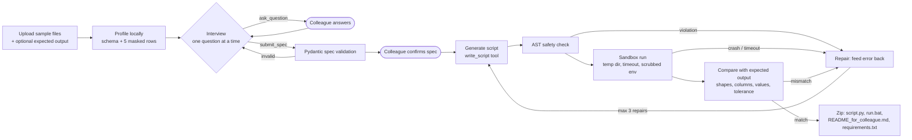
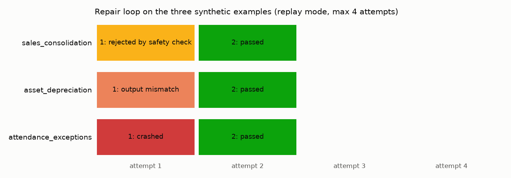
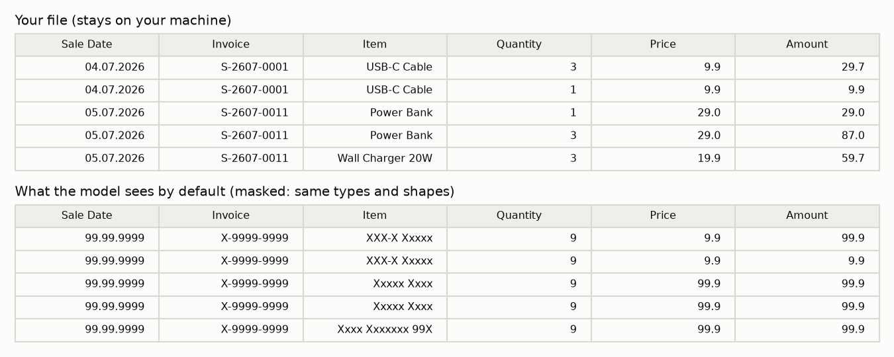
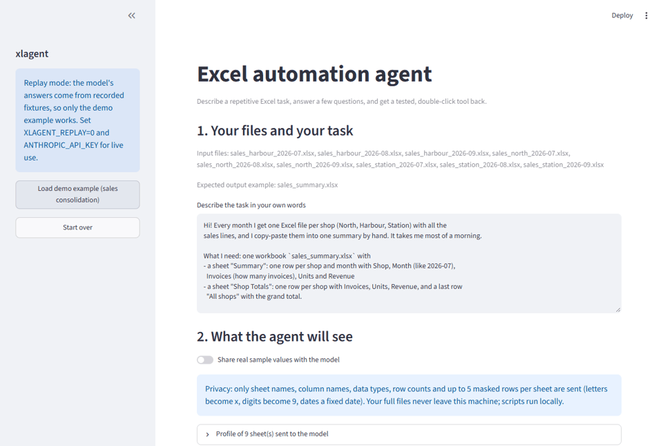
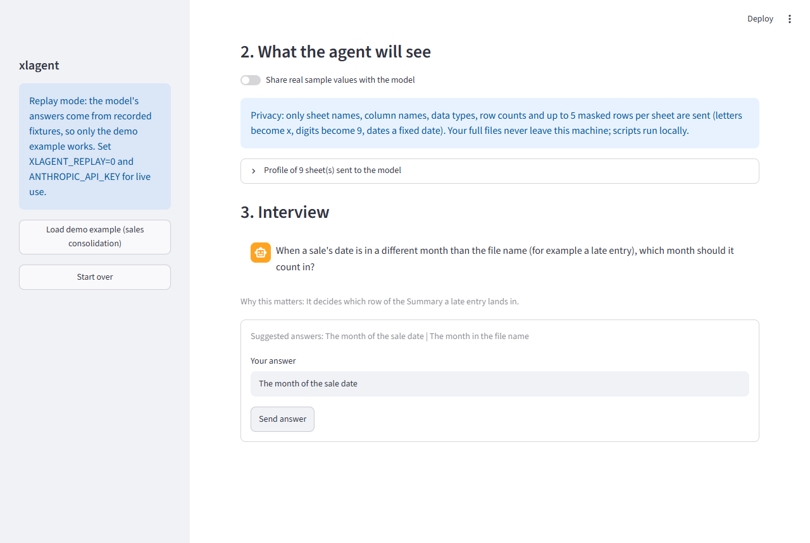
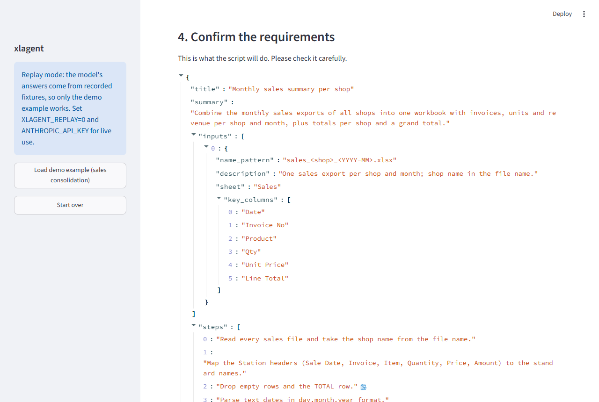
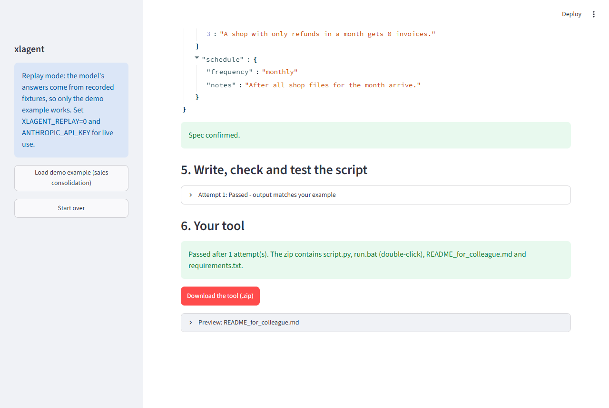

# Excel automation agent

[](https://github.com/GerasimoskiDesign/excel-automation-agent/actions/workflows/ci.yml)

**An AI agent that interviews a non-technical colleague about a manual Excel task, writes a Python script for it, tests the script in a sandbox on their own sample file, and hands back a double-click tool.**

Built as a prototype for internal tooling; all example files are synthetic.

## The problem

Colleagues in finance, sales operations and HR spend hours every month on the same Excel
routine: copy-paste a dozen exports into one summary, roll a depreciation schedule forward,
scan a time-clock export for exceptions. Each of these is a 50-line pandas script, but
writing them one by one does not scale, and the people who need them cannot write them.
The slow part is not the code; it is pinning down the rules ("does a refund count as an
invoice?") and proving the script is right on *their* files.

## What this does

The agent does the scoping interview, writes the script, proves it on the colleague's
sample file and packages it:



Three ways in, one agent behind them:

| Entry point | Mode | Command |
|---|---|---|
| Streamlit app | interactive interview, colleague confirms the spec | `python -m xlagent app` |
| HTTP API (FastAPI) | non-interactive: the agent makes assumptions and lists them | `python -m xlagent api` |
| n8n workflow | email with attachments in, zipped tool + assumptions out | [`integrations/n8n/`](integrations/n8n/README.md) |

Key pieces:

- **Profiling and privacy** (`profiling.py`): the model sees sheet names, column names,
  dtypes, row counts and up to 5 sample rows per sheet, **masked by default** (letters
  become `x`, digits `9`, dates a fixed date, so formats survive but values do not). A
  toggle in the UI sends real rows instead.
- **Interview** (`agent/interview.py`): the model has two tools, `ask_question` and
  `submit_spec`. The spec (inputs, steps, output format, business rules, edge cases,
  schedule) is validated with Pydantic; validation errors go back to the model.
- **Generation contract** (`harness.py`): the model writes only
  `run(input_paths, output_path)`. A fixed, human-written harness adds argument parsing,
  folder expansion and plain-language error messages, so `run.bat` works the same for every
  tool.
- **Repair loop** (`agent/pipeline.py`): safety rejection, crash, timeout, missing output
  or a diff against the expected file all become a `tool_result` for the next attempt; at
  most 1 + 3 attempts, each shown in the UI.
- **LLM layer** (`llm/`): a small provider interface, the Anthropic provider (adaptive
  thinking, effort from env, streaming), and **replay mode** with cassettes so tests, CI
  and the demo run without an API key.

### Safety model

What the static check (`safety.py`, AST-based) blocks before anything runs:

- any import outside the allowlist: `pandas, openpyxl, numpy, datetime, pathlib, re, math,
  collections` plus pure-computation stdlib modules (`typing, calendar, decimal,
  itertools, functools, statistics`). So `os`, `subprocess`, `socket`, `requests`,
  `shutil`, `importlib` are rejected by default;
- `eval`, `exec`, `compile`, `__import__`, `getattr`/`setattr`, `globals`/`vars`, `input`;
- dangerous attributes on any object (`.system`, `.popen`, `.rmtree`, `.unlink`, `.rmdir`,
  `.chmod`, `read_pickle`, `read_sql`, `read_html`, ...), including reach-through such as
  `pd.io.common.os.system`;
- dunder access (`__class__`, `__subclasses__`, `__builtins__`, ...);
- path literals that are absolute or contain `..` in `open()`, `Path()`, `read_*`/`to_*`;
- URL literals (`https://`, `ftp://`, `s3://` ...);
- module-level code other than imports, constants and function definitions.

What the sandbox (`sandbox.py`) adds at run time: a fresh temp directory containing only
*copies* of the sample files, `python -I`, a scrubbed environment (no API keys, no proxy
settings, temp/home inside the work dir), stdin closed, and a hard timeout.

**What it does not do:** the subprocess runs as the same OS user with normal file and
network access. Python is dynamic enough that a determined, hostile script could get past
a static check. This is a guard-rail against a well-meaning model making a careless
mistake, for **trusted internal use**. Running untrusted code would need a container or VM
with no network (see "What I'd do next").

## Results on synthetic data

All numbers below come from running this repo (`python -m xlagent eval --report-dir docs`)
on the synthetic examples in `examples/`, **in replay mode with hand-authored model
responses** (see the note below).

| Example | Task | Result | Attempts | Attempt outcomes | Cells compared | Assumptions listed |
|---|---|---|---|---|---|---|
| sales_consolidation | 9 shop files (3 shops x 3 months) to a summary per shop and month | pass | 2 | safety_rejected -> passed | 61 | 3 |
| asset_depreciation | 30-asset register to a monthly 2026 straight-line schedule | pass | 2 | mismatch -> passed | 1,655 | 3 |
| attendance_exceptions | September time-clock CSV + roster to three exception lists | pass | 2 | crashed -> passed | 74 | 3 |



Each example exercises a different branch of the repair loop: the first sales script
imports `os` and is rejected without running; the first depreciation script starts
depreciating one month early and fails the comparison on 282 of 328 opening values; the
first attendance script crashes on the `-` placeholder the time clock writes for missing
punches. In each case the feedback leads to a passing second attempt. Each sandbox run
takes about 1-2 seconds on a laptop.

The expected outputs are built by an independent reference implementation in
`examples_gen.py`, not by the replayed scripts, so a pass means two separately written
implementations agree. The examples are messy on purpose: header names that differ per
shop, text dates in `dd.mm.yyyy`, blank rows, a TOTAL row, refunds, disposals, fully
depreciated assets, swapped clock times.

What the model sees by default, versus the file on disk:



The Streamlit flow (demo example in replay mode):



| Upload and profile | Interview | Spec to confirm | Tested tool |
|---|---|---|---|
|  |  |  |  |

> **About the fixtures:** no API key was available while building this repo, so the four
> replay cassettes in `src/xlagent/fixtures/cassettes/` are **hand-authored**. They follow
> the Anthropic Messages API response shape exactly (`thinking`, `text` and `tool_use`
> content blocks, `stop_reason: "tool_use"`, usage counts estimated from text length), and
> the scripts they contain are real code that is executed, safety-checked and compared on
> every run. They show that the pipeline works end to end; they do **not** measure how well
> a live model does on these tasks. `scripts/author_fixtures.py` rebuilds them, and the
> recorder replaces them with real recordings (see Quickstart).

## Production context

Prototype; not yet deployed in production.

## Quickstart

Python 3.11+. Replay mode is the default, so no API key is needed for any of this.

**Windows (PowerShell)**

```powershell
git clone https://github.com/GerasimoskiDesign/excel-automation-agent.git
cd excel-automation-agent
python -m venv .venv
.\.venv\Scripts\Activate.ps1
python -m pip install --upgrade pip
pip install -e ".[dev]"
Copy-Item .env.example .env

python -m xlagent examples            # regenerate the synthetic examples (seed 42)
python -m xlagent eval                # all three examples end to end, replay mode
pytest                                # test suite
python -m xlagent app                 # Streamlit UI -> "Load demo example" in the sidebar
python -m xlagent api                 # HTTP API on http://127.0.0.1:8000/docs
```

**macOS / Linux**

```bash
git clone https://github.com/GerasimoskiDesign/excel-automation-agent.git
cd excel-automation-agent
python3 -m venv .venv
source .venv/bin/activate
python -m pip install --upgrade pip
pip install -e ".[dev]"
cp .env.example .env

python -m xlagent examples
python -m xlagent eval
pytest
python -m xlagent app
python -m xlagent api
```

Non-interactive build from the command line (what the API does per job):

```bash
python -m xlagent build --task-file examples/asset_depreciation/task.md \
  --inputs examples/asset_depreciation/inputs \
  --expected examples/asset_depreciation/expected/depreciation_2026.xlsx \
  --out out/depreciation_tool.zip
```

**Live mode and recording real fixtures.** Put a key in `.env`
(`ANTHROPIC_API_KEY=...`), set `XLAGENT_REPLAY=0`, and optionally `XLAGENT_RECORD=1`.
Every model call is then written to `recorded_cassettes/<session>.json` in the same format
as the bundled cassettes; `python -m xlagent eval --live` with recording on re-records all
three examples. Copy the files into `src/xlagent/fixtures/cassettes/` to replace the
hand-authored ones. In replay mode only the recorded tasks work (the session is matched
on mode, task text and input file names).

**Screenshots.** `pip install -e ".[docs]"`, start `python -m xlagent app --headless --port 8517`,
then `python scripts/capture_screenshots.py` (uses the installed Microsoft Edge).

## Project structure

```
excel-automation-agent/
├── src/xlagent/
│   ├── cli.py, __main__.py      # python -m xlagent examples | eval | build | app | api
│   ├── config.py                # settings from env / .env
│   ├── spec.py                  # Pydantic requirements spec (+ tool schema)
│   ├── profiling.py             # local profile + masking
│   ├── prompts.py               # system prompts and tool definitions
│   ├── agent/
│   │   ├── interview.py         # ask_question / submit_spec state machine
│   │   └── pipeline.py          # generate -> safety -> sandbox -> compare -> repair, jobs
│   ├── safety.py                # AST allowlist / denylist / contract check
│   ├── sandbox.py               # subprocess runner (temp dir, timeout, scrubbed env)
│   ├── compare.py               # output vs expected, tolerant and explained
│   ├── harness.py               # fixed CLI wrapper around the generated run()
│   ├── packaging.py             # zip: script.py, run.bat, README_for_colleague.md, requirements.txt
│   ├── llm/                     # provider interface, Anthropic provider, replay + recorder
│   ├── fixtures/cassettes/      # hand-authored replay cassettes (4)
│   ├── api.py                   # FastAPI jobs API
│   ├── app.py                   # Streamlit UI
│   ├── evaluation.py, charts.py # eval runner + README charts
│   ├── examples_gen.py          # seeded synthetic examples + reference outputs
│   └── xlsx_io.py               # deterministic xlsx/csv writing
├── examples/                    # 3 tasks: task.md, inputs/, expected/
├── scripts/
│   ├── author_fixtures.py       # builds the cassettes from fixture_sources/
│   ├── fixture_sources/         # the replayed scripts, as readable .py files
│   └── capture_screenshots.py   # Playwright screenshots of the Streamlit flow
├── integrations/
│   ├── n8n/                     # importable workflow, docker-compose, README
│   └── make/                    # placeholder
├── docs/                        # eval results + images
├── tests/                       # 112 pytest tests
├── Dockerfile                   # API image (used by the n8n compose file)
└── .github/workflows/ci.yml     # ruff + pytest + eval on ubuntu, Python 3.11
```

## Design decisions & trade-offs

- **Tools, not "reply in JSON".** Questions, specs and scripts arrive as `tool_use`
  blocks, so there are no code fences to strip and the payloads are parsed separately from
  any explanation. Tool choice stays `auto` (current Claude models reject forced tool use),
  so the prompts name the tool and the agent nudges once if the model answers in text.
- **The model writes `run()`, not the whole program.** Less generated code to check, and
  the harness (argument parsing, folder input, error messages) is identical and trusted in
  every tool.
- **Spec-first.** Asking the colleague to confirm a structured spec before any code exists
  catches misunderstandings when they are cheap. The colleague-facing README is rendered
  from that spec by a template, not by the model, so it cannot describe something the
  checks did not test.
- **Expected output as the oracle.** The strongest check available is "does it reproduce
  what you did by hand last month". Comparison ignores row order and float noise by
  default (configurable) and explains differences in words, because the diff doubles as
  the repair prompt. Without an expected file, the best the agent can say is "ran without
  errors", and the UI says exactly that.
- **Stop after 3 repairs.** Four failed attempts usually mean the spec or the data is the
  problem; another guess costs money and hides that.
- **Replay keyed on user input, not on prompts.** Cassettes are found by mode, task text and
  file names, so editing a prompt does not silently invalidate them, while the per-call
  stage check makes a change in control flow fail loudly.
- **Masking hides values but not column names.** Headers are needed to write code, and
  they can themselves be sensitive (e.g. a column named after a customer). The masked
  samples also hide values like `TOTAL` that are useful to the model; the interview and
  the task description have to cover those.
- **Non-interactive mode lists assumptions.** The API and n8n path cannot ask questions,
  so the model must state what it assumed, and the assumptions travel back with the zip.
- **Determinism.** The example generator is seeded (default 42) and normalises xlsx
  timestamps, so regenerated files are byte-identical (a test checks this); the deliverable
  zip is byte-identical for the same inputs. Live model output is not deterministic, which
  is why tests use replay.
- **Limitations.** The subprocess sandbox is not a security boundary (see Safety model).
  Jobs live in memory, so an API restart loses job state. Profiling assumes a header row in
  row 1. The hand-authored fixtures prove the plumbing, not live model quality. The n8n
  workflow has been imported into n8n 2.44.5 and rendered, but not yet run inside Docker
  or against a real mailbox.
- **What I'd do next.** Run scripts in a container with no network and a read-only file
  system; record real cassettes and a larger eval set (20+ tasks) to measure first-attempt
  pass rate per model and effort level; persist jobs in SQLite; let the colleague upload a
  second month of data after delivery as a regression test; add header-row detection.

## Tech stack

Python 3.11, pandas, openpyxl, NumPy, Pydantic v2, Anthropic Python SDK (Claude, default
`claude-opus-5-5`, adaptive thinking), Streamlit, FastAPI + Uvicorn, n8n, pytest, ruff,
GitHub Actions, matplotlib and Playwright (docs only).
