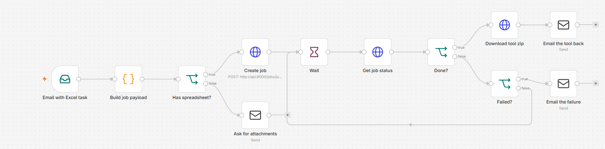

# n8n integration: email in, tool out

A colleague emails a task description with their sample files attached. n8n picks the
email up, sends it to the xlagent API in non-interactive mode, polls until the job is
finished, and emails the zipped tool back together with the assumptions the agent made.



*Screenshot of `excel_agent_workflow.json` imported into a local n8n 2.44.5 editor.*

## Flow

| Node | What it does |
|---|---|
| Email with Excel task | IMAP trigger for unread mails whose subject contains "excel task"; downloads attachments as `attachment_0..n` |
| Build job payload | Code node: email body becomes the task, `.xlsx`/`.csv` attachments become base64 files. An attachment named `expected_*.xlsx` is sent as the expected-output example |
| Has spreadsheet? | No spreadsheet attached: reply asking for the files |
| Create job | `POST /jobs/json` |
| Wait / Get job status / Done? / Failed? | Poll `GET /jobs/{id}` every 15 s until `done` or `failed` |
| Download tool zip | `GET /jobs/{id}/download` as binary `deliverable` |
| Email the tool back | Sends the zip plus the list of assumptions and the number of attempts |
| Email the failure | Sends the error so a person can follow up |

Why `/jobs/json` instead of the multipart `/jobs`: an email can carry any number of
attachments, and the HTTP Request node's form-data mode needs one parameter per file.
Building one JSON body in a Code node handles any number of files.

## Run it

```bash
cd integrations/n8n
docker compose up -d --build
docker compose exec n8n n8n import:workflow --input=/workflows/excel_agent_workflow.json
```

Then open http://localhost:5678, create the IMAP and SMTP credentials (the export contains
placeholders named `replace-me`), adjust `fromEmail`, and activate the workflow. The API
runs in replay mode by default; set `XLAGENT_REPLAY=0` and `ANTHROPIC_API_KEY` in your
shell (or an `.env` next to `docker-compose.yml`) for live use.

## What has been verified

- The workflow JSON is checked structurally in `tests/test_n8n_workflow.py` (node names
  and ids unique, every connection points to an existing node, every node reachable from
  the trigger, `$('Node')` references exist, no real credentials).
- `n8n import:workflow` succeeds with the n8n 2.44.5 CLI (installed from npm, run
  outside Docker), and the canvas above was captured from that instance with Playwright.
- Not yet verified: `docker compose up` and the import *inside the container* (Docker was
  not available on the build machine), and a full run against a real mailbox.
